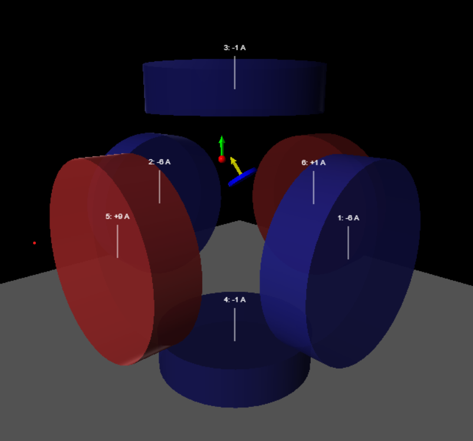

# 6-DOF Electromagnetic Control RL Agent

A Python simulation that uses reinforcement learning to control a magnetic
dipole with six electromagnets.



## Setup

```bash
python -m venv .venv
pip install -r requirements.txt
```

## Run the simulation

```bash
python main.py
```

## Train the agent

```bash
python train_agent.py
```

To watch a trained agent, run `python watch_agent.py`.

## Benchmark

Run the reproducible physics, environment, and checkpoint benchmark with:

```bash
python benchmark.py --json benchmark_results.json
```

See [BENCHMARK.md](BENCHMARK.md) for the latest measured results, methodology,
limitations, and resume-ready project points.
